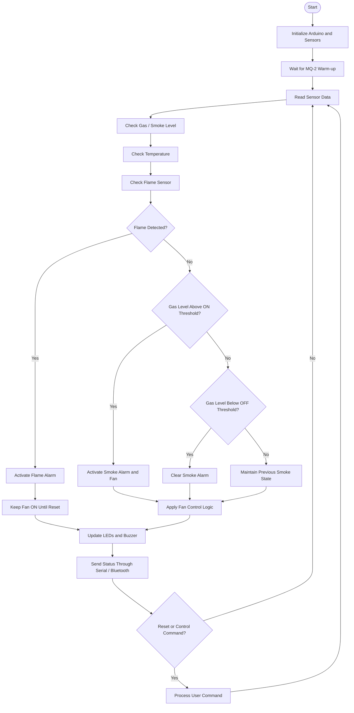

# System Flowchart

## 1. System Operation Flow

The following flowchart represents the working sequence of the Indoor Air-Quality Risk Detection and Ventilation Control System.

## 2. Explanation

1. The Arduino initializes the sensors and connected components.
2. The MQ-2 sensor is given time to warm up.
3. The system continuously reads sensor values.
4. Gas, temperature, and flame conditions are evaluated.
5. If a flame is detected, the flame alarm is activated and the fan remains ON until reset.
6. If smoke or gas crosses the ON threshold, the smoke alarm and fan are activated.
7. When the gas level falls below the OFF threshold, the smoke alarm is cleared.
8. The system updates the LEDs, buzzers, and fan according to its control logic.
9. Current status is made available through Serial and Bluetooth communication.
10. User commands are processed before the next monitoring cycle.

## 3. Important Note

This flowchart describes the current rule-based implementation. It does not represent a trained machine-learning prediction process. The actual fan operation also depends on the selected operating mode and active alarm conditions.